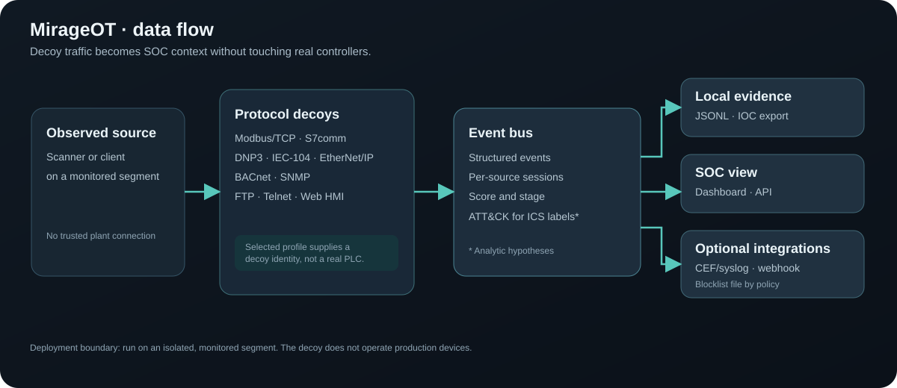
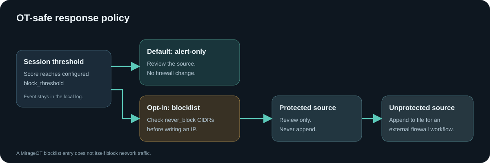

<div align="center">

# MirageOT 2.0

### Open-source ICS/OT deception sensor

Observe industrial decoy traffic, investigate source activity, and export evidence for a SOC.


</div>


*Live MirageOT 2.0 demo capture with synthetic loopback traffic. One of ten demo ports was unavailable on the Windows capture host, so nine decoys were online. The counts are not a performance or detection benchmark.*

## What it does

MirageOT runs selected decoy services and records interactions as structured events. It groups activity by source and shows a bounded live feed, scores, stages, and ATT&CK for ICS labels in a read-only web console. JSONL logs and an atomic threat-intelligence JSON export preserve local evidence. Optional CEF/syslog and webhook delivery use a bounded background queue.

The default response is **alert-only**. Optional blocklist mode writes candidate addresses to a file for an operator-controlled firewall workflow. MirageOT does not change firewall rules or control real industrial equipment.

| Capability | Current behavior |
|---|---|
| Decoys | Modbus/TCP, S7comm, DNP3, IEC 60870-5-104, EtherNet/IP, FTP, Telnet, Web HMI; optional SNMP and BACnet |
| Investigation | Per-source activity, bounded sessions, scores, stages, and a live console |
| Evidence | JSON Lines, threat-intelligence JSON, optional CEF/syslog and webhook |
| Response | Alert-only by default; optional file-based blocklist with `never_block` CIDRs |
| Runtime | Python 3.8+ standard library; no third-party Python dependencies |

## Architecture



Protocol listeners publish events to the event bus. The bus updates source sessions, local evidence, and the console; optional collectors receive alerts through a bounded queue. This describes data flow, not full protocol emulation.

## Run the local demo

```bash
git clone https://github.com/Am1rX/MirageOT.git
cd MirageOT
python mirageot.py --demo
```

Open **http://127.0.0.1:13888**. In a second terminal, send a verified Modbus smoke request:

```bash
python test.py
```

The request writes a decoy coil on `127.0.0.1:5502`, checks the response, and creates an event. Demo mode binds decoys to loopback and adds 5000 to service ports; S7comm becomes `5102`, for example. The default console moves from `8888` to `13888`. Check startup output for listeners that could not bind.

Run the regression suite:

```bash
python -m unittest discover -s tests -v
```

### Generate a honeytoken URL

```bash
python gen_tokens.py --decoy-ip 127.0.0.1 --web-port 13080 --modbus-port 5502 --out lures
```

The generated files are example lures. Visiting the `/token/` URL records a `token-trip` event when the Web HMI decoy is running. Review their content and placement before deployment. MirageOT does not provide an RDP decoy.

## Review saved events offline

Open [`replay/index.html`](replay/index.html) in a modern browser from a local clone, or download the file from GitHub and open it directly. MirageOT Replay starts with a synthetic case. To inspect your own events, choose **باز کردن فایل JSONL** and open the MirageOT `events.jsonl` file. The viewer accepts files up to 20 MiB and reports skipped invalid lines.

Use **میز تحلیل** to filter by source and inspect the UTC timeline and the original log line. **گزارش رخداد** summarizes the active source filter, shows up to 12 entries prioritized by recorded severity, and downloads a standalone HTML report. The export includes source addresses and selected event metadata. Raw log lines and the free-form `detail` field stay in the local viewer. The page works offline with no server, external assets, or upload.

## Protocol coverage

MirageOT is a **decoy sensor**, not a vendor-certified PLC emulator. Profiles advertise device identity; protocol depth varies.

| Protocol | Implemented behavior | Limit |
|---|---|---|
| Modbus/TCP | MBAP framing, reads of four decoy banks, single and multiple writes, exception responses | 128 synthetic points per bank |
| S7comm | TPKT/COTP connection confirmation and job telemetry | No PLC memory model |
| IEC 60870-5-104 | Framed STARTDT, STOPDT, and TESTFR U-frame responses | I/S frames observed only |
| EtherNet/IP | Encapsulation framing, RegisterSession and ListIdentity responses | No CIP object model |
| DNP3 | Link-header probe detection | No CRC-validated exchange or outstation response |
| SNMP, BACnet | Basic datagram framing detection | No full protocol response |
| FTP, Telnet, Web HMI | Bounded login interaction and decoy pages | No real authentication |

Technique IDs are **analytic hypotheses** about decoy interactions, not proof of intent or physical impact. Connections and login attempts alone receive no technique ID. See [MITRE ATT&CK for ICS](https://attack.mitre.org/matrices/ics/) for definitions.

## Response policy



`response_mode: "alert-only"` flags sources above `block_threshold` for operator review. In opt-in `blocklist` mode, addresses outside every `never_block` CIDR are written to a file for an **external** firewall integration. Protect production assets and approved scanners in `never_block` before enabling it. MirageOT itself never drops packets.

## Configuration and deployment

Copy and adapt [`config.example.json`](config.example.json):

```bash
cp config.example.json config.json
python mirageot.py --config config.json
```

On Windows PowerShell, use `Copy-Item config.example.json config.json`. The example writes to `/var/log/mirageot`; change those paths for a local Windows run. The `decoys` list selects listeners. SNMP and BACnet are available but disabled in the example. To enable an optional collector, rename `_optional_syslog` or `_optional_webhook` to `syslog` or `webhook` and replace its placeholder destination.

The web console binds to `127.0.0.1` by default, even when decoys bind to `0.0.0.0`. To use a different `console_host`, provide `MIRAGEOT_CONSOLE_TOKEN` with at least 16 characters. The API accepts a Bearer token; the dashboard retains an entered token in browser session storage. Put remote access behind TLS and network controls.

Low-numbered ports require suitable operating-system privileges or `CAP_NET_BIND_SERVICE`. The [Dockerfile](Dockerfile) and [systemd unit](mirageot.service) are deployment starting points. Check bind addresses, port publishing, capabilities, storage ownership, and collector egress for your environment. Isolate the sensor from production controllers and protect logs because login attempts may contain credentials.

| Path | Purpose |
|---|---|
| [`mirageot.py`](mirageot.py) | Compatibility CLI launcher |
| [`mirageot/`](mirageot/) | Maintained handlers, event bus, console, and configuration |
| [`tests/`](tests/) | Protocol, policy, and console regression tests |
| [`gen_tokens.py`](gen_tokens.py) | Example lure generator |
| [`test.py`](test.py) | Demo Modbus smoke request |
| [`ics_honeypot.py`](ics_honeypot.py) | Legacy standalone example |

## Scope and safety

Deploy only on networks you own or are authorized to monitor. Demo screenshots use synthetic loopback traffic and do not measure accuracy or throughput. The included tests cover selected request and response paths; they are not protocol conformance certification.

## License

[MIT](LICENSE)
