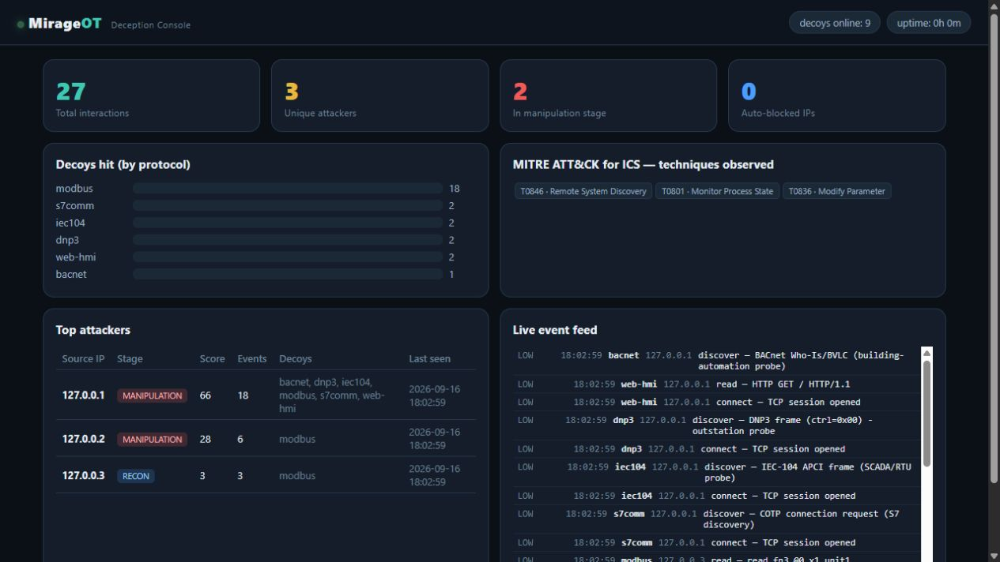

<div align="center">

# MirageOT

### An open-source ICS/OT deception sensor

Observe interactions with decoy industrial services, correlate activity by source, and send usable evidence to a SOC.


</div>



*Actual capture from the code in this repository, running in demo mode with synthetic traffic from three loopback addresses. The pictured run recorded 27 interactions; one of ten demo ports was unavailable on the Windows host, so nine decoys were online. These counts are a demonstration, not a benchmark.*

## What it does

MirageOT runs selectable protocol decoys and turns their interactions into a structured event stream. It tracks each source's actions, score, stage, protocols contacted, and ATT&CK for ICS labels. Operators can inspect activity in a live web console or export it to JSONL, threat-intelligence JSON, CEF/syslog, and an optional webhook.

The default response is **alert-only**. MirageOT does not control a real PLC or automatically change a firewall. Its optional blocklist mode writes candidate IPs to a file for a separate, operator-controlled firewall workflow.

### At a glance

| Capability | Current behavior |
|---|---|
| Decoy listeners | Modbus/TCP, S7comm, DNP3, IEC 60870-5-104, EtherNet/IP, BACnet, SNMP, FTP, Telnet, Web HMI |
| Session context | Per-source activity, cumulative score, `RECON` / `INTERACTION` / `MANIPULATION` stages |
| Operator view | Local dashboard with protocol breakdown, source table, technique labels, and live feed |
| Evidence | JSON Lines event log and JSON indicator export |
| Integrations | Optional CEF/syslog and webhook delivery |
| Response | `alert-only` by default; optional blocklist file with `never_block` CIDR protection |
| Runtime | Python standard library; no third-party Python packages |

## Architecture


The decoys receive traffic and publish events to a central event bus. The bus updates per-source sessions and feeds local evidence, the console, and optional integrations. The diagram describes the data flow in the current implementation; it does not imply full emulation of every industrial protocol.

## Try the demo

Requires Python 3.8 or newer. Clone the repository and bind the demo to localhost:

```bash
git clone https://github.com/Am1rX/MirageOT.git
cd MirageOT
python mirageot.py --demo --host 127.0.0.1
```

Open **http://127.0.0.1:13888**. In a second terminal, send the included Modbus smoke request:

```bash
python test.py
```

Expected Modbus response from the current example:

```text
b'\x00\x01\x00\x00\x00\x06\x01\x05\x00\x00\xff\x00'
```

The dashboard should show the new interaction. A local demonstration with additional read and write requests produced this JSONL event:

```json
{"time":"2026-09-16T18:01:06","protocol":"modbus","src_ip":"127.0.0.3","action":"modify-param","detail":"write-reg @5=4202 <<SETPOINT TAMPER>>","severity":"HIGH","technique":{"id":"T0836","name":"Modify Parameter"},"session_score":16,"session_stage":"INTERACTION"}
```

`--demo` adds 5000 to service ports. For example, Modbus/TCP moves from `502` to `5502`, S7comm from `102` to `5102`, and the console from `8888` to `13888`. A service whose port is occupied will be skipped; check the startup output and **decoys online** count.

### Generate a honeytoken URL

```bash
python gen_tokens.py --decoy-ip 127.0.0.1 --web-port 13080 --out lures
```

This creates local lure files, including a URL under `/token/`. Visiting that URL records a `token-trip` event. The generator also writes an RDP shortcut, but MirageOT does **not** provide an RDP decoy; use only lures that point to listeners you actually deployed.

## Protocol coverage

MirageOT is a **decoy sensor**, not a vendor-certified PLC emulator. The advertised device profile supplies a plausible identity; protocol depth varies.

| Protocol | What this version handles |
|---|---|
| Modbus/TCP | Read and write requests against a decoy register bank; action logging |
| S7comm | TPKT/COTP connection request and basic S7 probe logging |
| DNP3 | Start-byte/frame probe recognition and logging |
| IEC-104 | APCI probe recognition and a STARTDT-style response |
| EtherNet/IP | Basic encapsulation command recognition, including ListIdentity/RegisterSession |
| BACnet, SNMP | Datagram probe recognition and logging |
| FTP, Telnet, Web HMI | Banners, login interaction, and Web HMI honeytoken URL |

The protocol handlers in this repository are intentionally limited. Use a real protocol conformance suite before treating a response as standards-compliant. ATT&CK labels are **analytic hypotheses**, not proof of attacker intent or physical process impact. In particular, a label such as `Loss of Safety` refers to interaction with a configured *decoy* point; no physical safety system is affected. See [MITRE ATT&CK for ICS](https://attack.mitre.org/matrices/ics/) for technique definitions.

## OT-safe response


`response_mode: "alert-only"` is the default. When a source crosses `block_threshold`, an operator review message is emitted. To opt into `blocklist` mode, configure `never_block` with the production asset and scanner CIDRs that must never be added. Even in that mode, the file is only a recommendation for an **external** firewall integration; MirageOT does not drop packets itself.

## Configuration and deployment

Start with [`config.example.json`](config.example.json):

```bash
cp config.example.json config.json
python mirageot.py --config config.json
```

On Windows, copy the file with `Copy-Item config.example.json config.json` in PowerShell. Edit the profile, decoy list, ports, output paths, and optional SIEM/webhook destinations for your lab. Binding the real low-numbered ports on Linux requires suitable privileges or `CAP_NET_BIND_SERVICE`. A [`Dockerfile`](Dockerfile) and [`systemd` unit](mirageot.service) are included as deployment starting points.

**Keep the current web console on a trusted interface.** In this version it shares the configured `host` bind address and has no built-in authentication. For a laptop demo, the command above explicitly binds everything to `127.0.0.1`. In a monitored OT segment, isolate the sensor, restrict console access with network controls, allow only required outbound destinations, and protect logs because login attempts can contain credentials.

### Main files

| Path | Purpose |
|---|---|
| [`mirageot.py`](mirageot.py) | Decoy listeners, event bus, dashboard, response policy |
| [`config.example.json`](config.example.json) | Configuration template |
| [`gen_tokens.py`](gen_tokens.py) | Optional lure generator |
| [`test.py`](test.py) | One Modbus smoke request for demo mode |
| [`ics_honeypot.py`](ics_honeypot.py) | Earlier, smaller standalone honeypot example |

## Scope and safety

Deploy only on networks you own or are authorized to monitor. Keep the sensor separate from production controllers. This repository includes a smoke request, not a comprehensive protocol test suite or published performance benchmark. The screenshots use synthetic loopback traffic and demonstrate the UI, not detection accuracy.

## License

[MIT](LICENSE)
